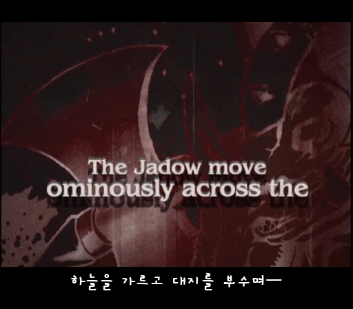
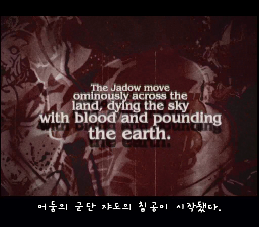
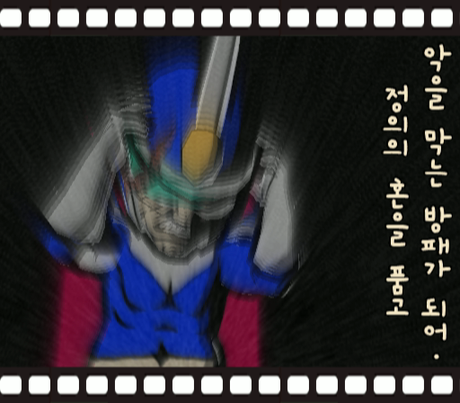
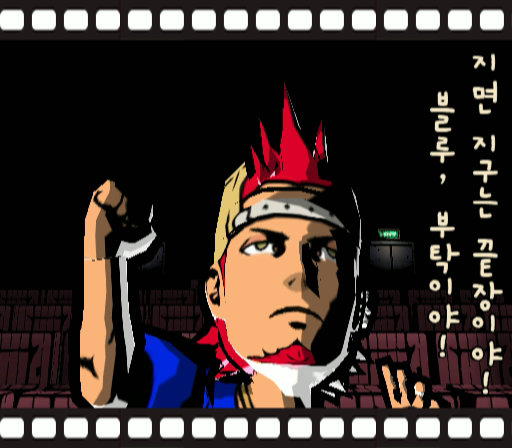

# 뷰티풀죠 리바이벌 게임큐브 한국어 패치 v0.901

일본판 **GameCube / GVFJ08**용 한국어 패치 **v0.901**입니다. v0.9의 실기 오프닝 멈춤 제보에 대응해 실행 파일 구조와 디스크 배치를 보완했습니다.

- 추가 DOL 실행 영역을 **32바이트 정렬**하고 끝의 누락 패딩 **25바이트**를 채웠습니다.
- 메모리 예약용 실행 코드를 **TEXT 구역**으로 분리했습니다.
- 원본 파일 **312개 중 311개 위치**를 유지하며, 확장된 타이틀 자원 한 개만 빈 공간으로 옮겼습니다. 원본 영상·음성 **102개의 내용과 디스크 위치**가 원본과 같습니다.
- v0.9의 한글 게임 자원 **312개**, 자막·글꼴·렌더러 코드와 데이터는 그대로 유지했습니다. 이미지 **1,443종·4,206곳**, 네이티브 자막 **95개**를 포함합니다.

관련 검사 **44개**와 패처 검사 **11개**, 원본 ISO에 완성 EXE를 실제 적용한 뒤 저장 결과 해시 대조를 통과했습니다. 오프닝 **2,432프레임** 전체를 건너뛰지 않고 재생해 종료 후 게임 렌더링 복귀를 확인했고, 새 게임의 첫 대사 장면까지 확인했습니다. 별도로 CPU 캐시 정확도를 켜고 v0.9와 v0.901 각각 오프닝 **1,100프레임**을 비교했습니다.

**실기 프리징 해소는 아직 확인되지 않았습니다.** 제보의 정확한 장면과 구동 환경은 알려지지 않았고, 에뮬레이터에서 같은 멈춤을 재현하지 못했습니다. 이번판은 확인한 구조상 위험을 줄인 호환성 보완판입니다. 영상·음성 재인코딩은 없습니다.

## 적용 방법

1. [EXE 패처](https://github.com/OldManCraveGuitars-bit/GC-Viewtiful-Joe-Revival-Kr/releases/download/v0.901/Viewtiful-Joe-Revival-Kr-Patcher-v0.901.exe)를 실행합니다. 필요한 파일이 EXE 하나에 포함되어 있습니다.
2. 수정되지 않은 **일본판 원본 ISO/GCM**과 새 저장 위치를 선택합니다. RVZ는 돌핀에서 먼저 ISO로 변환합니다.
3. 원본 확인·적용·저장된 결과의 SHA-256 대조가 끝날 때까지 기다립니다. 기존 한글 롬에는 덧씌우지 않습니다.

[배포 ZIP](https://github.com/OldManCraveGuitars-bit/GC-Viewtiful-Joe-Revival-Kr/releases/download/v0.901/GC-Viewtiful-Joe-Revival-Kr-v0.901.zip) · [Xdelta](https://github.com/OldManCraveGuitars-bit/GC-Viewtiful-Joe-Revival-Kr/releases/download/v0.901/GC-Viewtiful-Joe-Revival-Kr-v0.901.xdelta) · [스크린샷](https://github.com/OldManCraveGuitars-bit/GC-Viewtiful-Joe-Revival-Kr/releases/download/v0.901/GC-Viewtiful-Joe-Revival-Kr-v0.901-screenshots.zip) · [SHA-256 목록](https://github.com/OldManCraveGuitars-bit/GC-Viewtiful-Joe-Revival-Kr/releases/download/v0.901/SHA256SUMS.txt)

## SHA-256

| 파일 | SHA-256 |
| --- | --- |
| 원본 ISO | `2b4dd8b25cf810a92bfdb153cd1632fd7229892b1cfd92ac97ec8498c6bdf480` |
| 완성 ISO | `9fbd3539731329243c1db3a58bda280289f2a23a2ebca37a8bf4f8d7f49c6018` |
| Xdelta | `e5b37834462d776a8251243636efa54aa65753e02e50972054c7631c514a09a3` |
| EXE 패처 | `35f8b46335dd47141665b3af21acc55d3f6fb3513de6c6fb3d221ac04f088c78` |

## 검수 이미지

다음 네 장면은 v0.901의 실제 게임 XFB를 에뮬레이터에서 캡처했습니다. 실기 캡처가 아닙니다.

### 기존 이미지 한글화

간판·종이 그림은 v0.9와 같습니다. 아래는 디스크 텍스처 미리보기입니다.

## 검증 자료와 라이선스

[호환성 검수 결과](docs/verification/hardware-v0.901.json) · [이번 캡처의 ISO 해시](docs/verification/v0.901-screenshots.json) · [실제 EXE 적용 결과](docs/verification/v0.901-actual-apply.json)

타이틀 대표 이미지는 기존 촬영본이며, 해당 타이틀 자원은 v0.9에서 바뀌지 않았습니다. 기존 캡처의 촬영판과 해시는 `docs/verification/screenshots.json`에 보존했습니다. 저해상도 장식 문구의 장면에 맞는 재디자인 등 기존 한글화 범위와 예외도 유지합니다.

원본 ROM은 포함하지 않습니다. 패처 코드는 `LICENSE-PATCHER.md`, 내장 Xdelta는 `third_party`의 라이선스를 따릅니다. v0.8·v0.9의 태그와 배포 파일은 보존합니다.
