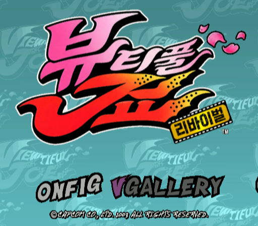
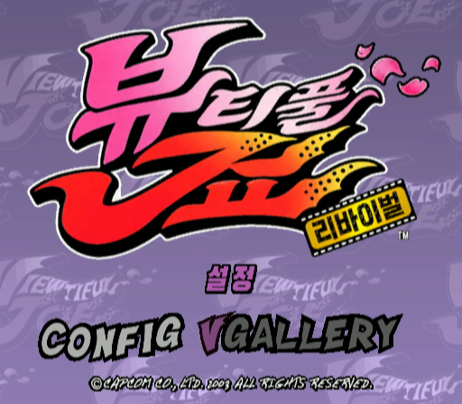
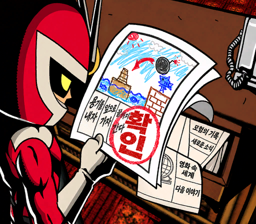

# 뷰티풀죠 리바이벌 게임큐브 한국어 패치 v0.92

일본판 **GameCube / GVFJ08**용 한국어 패치 **v0.92**입니다. CONFIG에 들어갔다 돌아오면 C가 오른쪽으로 밀리고 ‘설정’이 사라지던 문제를 수정했습니다.

- 짧아진 한글 메뉴 뒤에 이전 화면의 글자 포인터가 남아 같은 글자를 두 번 이동시키던 원인을 제거했습니다.
- **CONFIG 진입·복귀 3회**, 글자 수·중복 포인터·좌표 복원과 메인 메뉴 복귀를 에뮬레이터에서 확인했습니다. 원본 일본판과 v0.901도 같은 순서로 대조했습니다.
- 관련 검사 **44개**와 패처 검사 **11개**, 완성 v0.92 EXE의 원본 ISO 실제 적용·저장 결과 해시 대조를 통과했습니다.
- 원래 메뉴 효과·글꼴·디자인과 기존 한글화를 유지합니다. 게임 자원 **312개의 내용과 위치**는 v0.901과 같습니다. 이미지 **1,443종·4,206곳**, 네이티브 자막 **95개**를 포함합니다.
- v0.901의 DOL 정렬·코드 구역 분리·원본 디스크 배치 보완을 유지합니다. 영상·음성 **102개의 내용과 위치**는 원본과 같습니다. 영상 재인코딩은 없습니다.

**이전 실기 오프닝 프리징 제보의 실기 해소 여부는 여전히 미확인**입니다. 이번 검수는 에뮬레이터에서 원래 입력 처리 지점에 QA용 버튼 에지를 공급해 수행했으며, 실기·물리 컨트롤러 검증으로 표시하지 않습니다.

## 적용 방법

1. [EXE 패처](https://github.com/OldManCraveGuitars-bit/GC-Viewtiful-Joe-Revival-Kr/releases/download/v0.92/Viewtiful-Joe-Revival-Kr-Patcher-v0.92.exe)를 실행합니다. 필요한 파일이 EXE 하나에 포함되어 있습니다.
2. 수정되지 않은 **일본판 원본 ISO/GCM**과 새 저장 위치를 선택합니다. RVZ는 먼저 돌핀에서 ISO로 변환합니다.
3. 원본 확인·패치 적용·저장된 결과의 SHA-256 대조가 끝날 때까지 기다립니다. 기존 한글 롬에 덧씌우지 않습니다.

[배포 ZIP](https://github.com/OldManCraveGuitars-bit/GC-Viewtiful-Joe-Revival-Kr/releases/download/v0.92/GC-Viewtiful-Joe-Revival-Kr-v0.92.zip) · [Xdelta](https://github.com/OldManCraveGuitars-bit/GC-Viewtiful-Joe-Revival-Kr/releases/download/v0.92/GC-Viewtiful-Joe-Revival-Kr-v0.92.xdelta) · [스크린샷](https://github.com/OldManCraveGuitars-bit/GC-Viewtiful-Joe-Revival-Kr/releases/download/v0.92/GC-Viewtiful-Joe-Revival-Kr-v0.92-screenshots.zip) · [SHA-256 목록](https://github.com/OldManCraveGuitars-bit/GC-Viewtiful-Joe-Revival-Kr/releases/download/v0.92/SHA256SUMS.txt)

## SHA-256

| 파일 | SHA-256 |
| --- | --- |
| 원본 ISO | `2b4dd8b25cf810a92bfdb153cd1632fd7229892b1cfd92ac97ec8498c6bdf480` |
| 완성 ISO | `d6ad7ef4d79d0d33f45a1bf01ae77d67ba2e81ba535ab9f34585eaeefaf02c62` |
| Xdelta | `8131948de7315e7439cc9390cc4edbfd538a137d4ea209633b6c6391d457a4a8` |
| EXE 패처 | `6b6d5722082e6803cc3824937438813dd621771f419c256f506b4aaa5f3de2c5` |

## CONFIG 복귀 전후

v0.901 수정 전 — C가 오른쪽으로 밀리고 ‘설정’이 사라졌습니다.

v0.92 수정 후 — 세 번째 CONFIG 복귀에서도 글자 위치가 유지됩니다.

원본 일본판 비교:

## 기존 이미지 한글화

다음은 유지한 간판·종이의 디스크 텍스처 미리보기입니다.

## 검증 자료와 라이선스

[메뉴 복귀 검수](docs/verification/config-return-v0.92.json) · [이번 캡처의 ISO 해시](docs/verification/v0.92-screenshots.json) · [완성 EXE 실제 적용](docs/verification/v0.92-actual-apply.json)

대표 타이틀과 이번 전후 이미지는 실제 게임 XFB의 에뮬레이터 캡처입니다. 이전 캡처와 검수 자료는 원래 버전·해시 기록을 유지했습니다. 원문을 판독할 수 없는 저해상도 장식 문구를 장면에 맞게 재디자인한 기존 한글화 범위와 예외도 유지합니다.

원본 ROM은 포함하지 않습니다. 패처 코드는 `LICENSE-PATCHER.md`, 내장 Xdelta는 `third_party`의 라이선스를 따릅니다. 기존 v0.8·v0.9·v0.901 태그와 배포 파일은 보존합니다.
