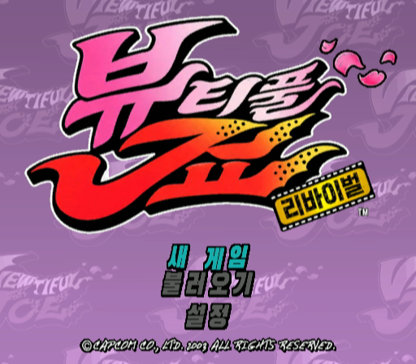
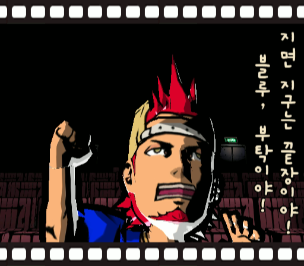
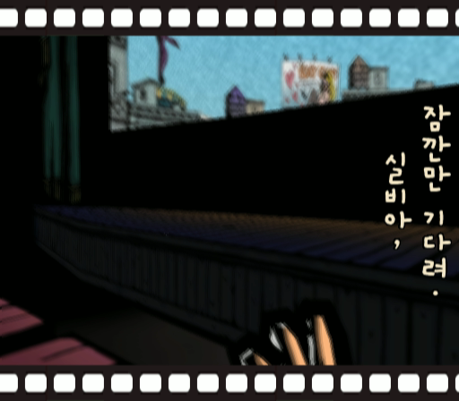
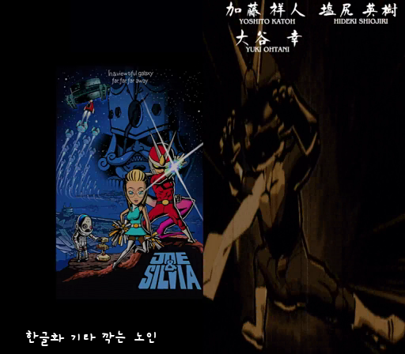
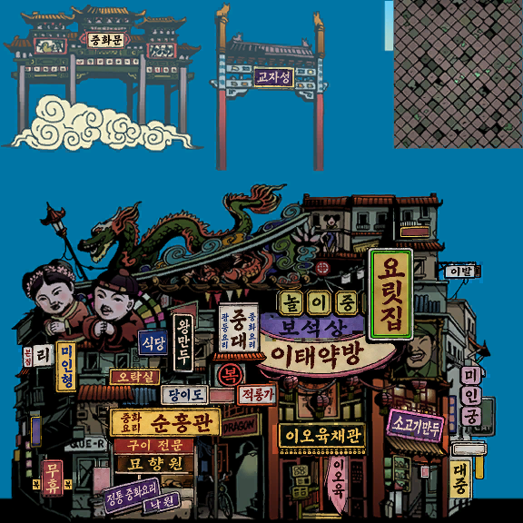
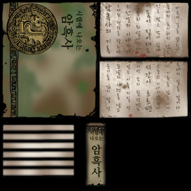

# 뷰티풀죠 리바이벌 게임큐브 한국어 패치 v0.9

일본판 **GameCube / GVFJ08**용 한국어 패치 **v0.9**입니다. 타이틀·메뉴·본편과 추가 캐릭터 대사, 네이티브 자막과 이미지 한글화를 포함합니다.

- 승인 이미지 **1,443종·4,206개 사용 위치**, 네이티브 자막 **95개**를 반영했습니다.
- v0.8 이후 간판·배경 글자·소품 이미지 **10종·21곳**을 추가/보완했습니다. 간판은 선택한 디자인과 중앙 배치를 유지하고 파란 빈 배경의 블록 색 차이를 정리했습니다.
- 죠의 종이는 종이 원근과 굴곡을 따르는 글씨, 본문과 자연스럽게 겹치는 확인 도장을 적용했습니다. 편지·책 내지·작은 표기도 포함합니다.
- 기존 메뉴 효과·대사·툴팁 정렬·저장 내용 겹침 수정과 영상·음성 **102개**를 유지합니다. 영상에 자막을 합성해 인코딩하지 않았습니다.

저해상도로 원문을 판독할 수 없는 장식 문구는 장면에 맞는 한국어로 재디자인했습니다. 정확한 원문 전사로 기록하지 않습니다. 실기 플레이 검수는 요청에 따라 원본 데이터 대조로 대체했습니다.

## 적용 방법

1. [EXE 패처](https://github.com/OldManCraveGuitars-bit/GC-Viewtiful-Joe-Revival-Kr/releases/download/v0.9/Viewtiful-Joe-Revival-Kr-Patcher-v0.9.exe)를 실행합니다. EXE 하나에 필요한 파일이 포함되어 있습니다.
2. 수정되지 않은 **일본판 원본 ISO/GCM**과 새 ISO 저장 위치를 선택합니다. RVZ는 돌핀에서 먼저 ISO로 변환합니다.
3. 패처가 원본 확인, 적용, 저장된 완성본의 SHA-256 검사를 차례로 수행합니다. 기존 한글 롬에 덧씌우는 패치가 아닙니다.

[배포 ZIP](https://github.com/OldManCraveGuitars-bit/GC-Viewtiful-Joe-Revival-Kr/releases/download/v0.9/GC-Viewtiful-Joe-Revival-Kr-v0.9.zip) · [Xdelta](https://github.com/OldManCraveGuitars-bit/GC-Viewtiful-Joe-Revival-Kr/releases/download/v0.9/GC-Viewtiful-Joe-Revival-Kr-v0.9.xdelta) · [스크린샷·텍스처 미리보기](https://github.com/OldManCraveGuitars-bit/GC-Viewtiful-Joe-Revival-Kr/releases/download/v0.9/GC-Viewtiful-Joe-Revival-Kr-v0.9-screenshots.zip) · [SHA-256 목록](https://github.com/OldManCraveGuitars-bit/GC-Viewtiful-Joe-Revival-Kr/releases/download/v0.9/SHA256SUMS.txt)

## SHA-256

| 파일 | SHA-256 |
| --- | --- |
| 원본 ISO | `2b4dd8b25cf810a92bfdb153cd1632fd7229892b1cfd92ac97ec8498c6bdf480` |
| 완성 ISO | `eb4bfed2f65f60b751039beef9705557400b69f85d9c05c3617710d52030e981` |
| Xdelta | `fb8df35d859322df3583a7e3fd1937d3db127cf002c87daa79b898823bdc5c69` |
| EXE 패처 | `ddd928b0d1a6b9a7e2a31c6368b348666d40918615ace5a4f305795461a8c28b` |

## 이미지

기존 플레이 캡처는 v0.8에서 촬영한 기록이며 [촬영 ISO 해시](docs/verification/screenshots.json)를 유지합니다. 추가 이미지는 디스크에서 검증한 **텍스처 미리보기**로 구분했습니다.

### v0.9 추가 텍스처 미리보기

## 검증과 라이선스

패처 회귀 검사 11개, 완성 EXE의 내부 파일·화면 생성 검사, 실제 원본 ISO 적용과 저장 결과 해시 검사를 통과했습니다. 이미지 변경 21곳 밖의 전체 롬 바이트는 검증된 v0.8과 같습니다. 모든 장면을 새로 플레이했다고 표시하지 않습니다.

원본 ROM은 포함하지 않습니다. 패처 코드는 `LICENSE-PATCHER.md`, 내장 Xdelta는 `third_party`의 라이선스를 따릅니다. v0.8은 기존 태그와 릴리스에서 계속 받을 수 있습니다.
