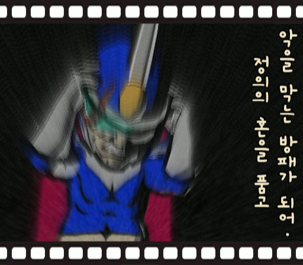
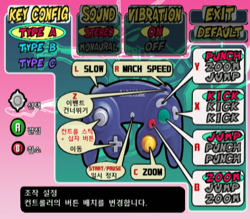
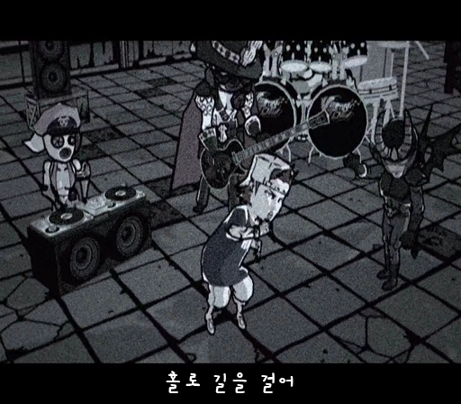

<p align="center"></p>

# 뷰티풀죠 리바이벌 한국어 패치 v0.8

게임큐브 일본판 **Viewtiful Joe Revival / GVFJ08**용 한국어 패치입니다. Windows EXE 패처와 Xdelta를 제공합니다.

**한글화 기타 깍는 노인**

## 다운로드

- **[EXE 패처 다운로드](https://github.com/OldManCraveGuitars-bit/GC-Viewtiful-Joe-Revival-Kr/releases/download/v0.8/Viewtiful-Joe-Revival-Kr-Patcher-v0.8.exe)** — 별도 Python·xdelta 설치 없이 실행
- [패처·안내 묶음 ZIP](https://github.com/OldManCraveGuitars-bit/GC-Viewtiful-Joe-Revival-Kr/releases/download/v0.8/GC-Viewtiful-Joe-Revival-Kr-v0.8.zip)
- [Xdelta](https://github.com/OldManCraveGuitars-bit/GC-Viewtiful-Joe-Revival-Kr/releases/download/v0.8/GC-Viewtiful-Joe-Revival-Kr-v0.8.xdelta) · [SHA-256 목록](https://github.com/OldManCraveGuitars-bit/GC-Viewtiful-Joe-Revival-Kr/releases/download/v0.8/SHA256SUMS.txt) · [스크린샷 묶음](https://github.com/OldManCraveGuitars-bit/GC-Viewtiful-Joe-Revival-Kr/releases/download/v0.8/GC-Viewtiful-Joe-Revival-Kr-v0.8-screenshots.zip)
- [v0.8 릴리스 전체 보기](https://github.com/OldManCraveGuitars-bit/GC-Viewtiful-Joe-Revival-Kr/releases/tag/v0.8)

원본 게임 파일은 포함하지 않습니다. 본인이 보유한 지원 원본을 준비해 주세요.

## 적용 방법

1. 일본판 **GVFJ08 원본 ISO/GCM**을 준비합니다. RVZ는 돌핀에서 ISO로 변환한 뒤 사용합니다.
2. Windows 10/11 64비트에서 EXE 패처를 실행합니다.
3. 원본 파일과 **저장할 새 ISO**를 지정하고 **한글 패치 시작**을 누릅니다.
4. 원본 검사 → 패치 적용 → 저장된 ISO 검사가 모두 완료되면 완성본을 사용합니다.
5. 돌핀 기기로 옮길 때는 완성 ISO와 함께 생성된 **동일 이름의 XML**도 같은 폴더에 복사합니다. XML은 목록 제목을 `뷰티풀죠 리바이벌`로 지정하는 보조 파일입니다.

원본과 기존 출력 파일은 덮어쓰지 않습니다. 출력 폴더에 약 **1.5 GB 이상**의 여유 공간이 필요합니다. 다른 지역판이나 이미 패치한 ISO에는 적용하지 않습니다.

Xdelta를 직접 사용할 경우:

```text
xdelta3 -d -s original.iso GC-Viewtiful-Joe-Revival-Kr-v0.8.xdelta Viewtiful-Joe-Revival-Kr-v0.8.iso
```

## 반영 내용

- 원작 디자인의 **뷰티풀죠** 타이틀·리바이벌 표찰과 **새 게임 / 불러오기 / 설정**. 기존 선택·글자 움직임 효과 유지.
- 본편·추가 캐릭터 대사와 설명문, 주요 일본어 UI. 반각 공백과 대사 열의 왼쪽→오른쪽 읽기 순서 적용.
- 승인 이미지 1,435종을 4,190개 사용 위치에 반영. 보스 이름 로고 8종도 한국어로 정리.
- 영상·중요 일반/전투 음성용 **게임 내 자막 95개**. 원본 영상에 자막을 입혀 인코딩하지 않았습니다.
- 하단 설명창 29종의 여백·배치 정리. 저장 내용의 화수·제목 겹침 해소 및 높이 조정.
- 엔딩의 카미야 히데키·이나바 아쓰시·미카미 신지 이름 한글화. 이후 원본 크레딧에 `한글화 기타 깍는 노인`을 표시하고 마지막 단체 일러스트 직전에 숨김.

원본 영문 로고·기술명과 배경·소품의 추가 식자는 번역 범위에서 제외했습니다. 일부 판독이 어려운 음성·노랫말은 확인 가능한 의미를 중심으로 축약했습니다.

## SHA-256

지원 원본과 완성 ISO의 크기는 각각 **1,459,978,240바이트**입니다.

| 대상 | SHA-256 |
| --- | --- |
| 원본 일본판 ISO/GCM | `2b4dd8b25cf810a92bfdb153cd1632fd7229892b1cfd92ac97ec8498c6bdf480` |
| 완성 한국어 ISO v0.8 | `94f20dd50f0323cca62e6e15f97796803611be5f9258e03860ea874c49863b3c` |
| EXE 패처 | `54a9dc8f181aa48072128590ba85acbca1178955808aa05b9ae7e786a94f35ed` |
| Xdelta | `9367876999700a965c5fd15c9429e2cee003b6aaea2d6317027feddb6ee7de36` |
| 패처 묶음 ZIP | `b1437be20231c416fda90f365cbbecbba9973207e355c19452b65c30af046330` |

[전체 배포 파일 해시](SHA256SUMS.txt) · [원본/결과 이미지 정보](docs/verification/expected-images.json)

## 스크린샷

<table>
<tr><td align="center">오프닝 자막<br></td><td align="center">이야기 대사<br></td></tr>
<tr><td align="center">장면 대사<br></td><td align="center">설정 화면<br></td></tr>
<tr><td align="center">뮤직비디오 자막 검수<br></td><td align="center">엔딩 표기 검수<br></td></tr>
</table>

타이틀·오프닝·대사·설정은 v0.8 출력 ISO에서 새로 캡처했습니다. 뮤직비디오·엔딩은 영상·자막 데이터의 동일성을 확인한 기존 검수 화면입니다. [캡처 출처와 해시](docs/verification/screenshots.json)

## 검증 범위

- 배포 EXE를 실제 원본 ISO에 적용한 뒤, 저장된 결과 ISO가 위 완성본 해시와 일치하는지 확인했습니다.
- 원본 보존, 기존 출력 파일 보호, 잘못된 원본/손상된 패치 거부, 취소 시 임시 파일 정리 등 패처 검사 10개를 통과했습니다. 한글·공백 경로와 표시 이름 XML 저장도 확인했습니다.
- 원본 영상·음성 102개는 바이트 단위로 같습니다. 허용 범위 밖의 리소스·실행 코드 변경은 0건입니다.
- **실제 게임큐브 기기에서의 플레이 검수는 실시하지 않았습니다.** 원본 데이터 비교와 Dolphin 검수를 사용했으며 모든 장면을 새로 플레이했다는 의미는 아닙니다.

[배포 검증 요약](docs/verification/release-v0.8.json)

## 패처 소스 빌드

Windows, Python 3.11 이상과 Tcl/Tk가 필요합니다.

```powershell
python -m pip install -r requirements-build.txt
python -m unittest discover -s tests -v
python -m PyInstaller --noconfirm --clean --onefile --windowed --name Viewtiful-Joe-Revival-Kr-Patcher-v0.8 --add-data "patcher/resources;resources" patcher/patcher.py
```

빌드 결과 EXE는 `dist`에 생성됩니다. 게임 원본은 테스트·소스 저장소에 포함하지 않습니다. 작은 자체 제작 테스트 데이터로 패처의 파일 보호와 변환 동작을 검사합니다.

패처·테스트 소스 라이선스는 [MIT](LICENSE-PATCHER.md), 포함된 xdelta는 [Apache 2.0](third_party/xdelta3-LICENSE.txt)입니다. [서드파티 안내](third_party/NOTICE.md). 게임·로고·스크린샷의 권리는 CAPCOM 및 원권리자에게 있습니다.
