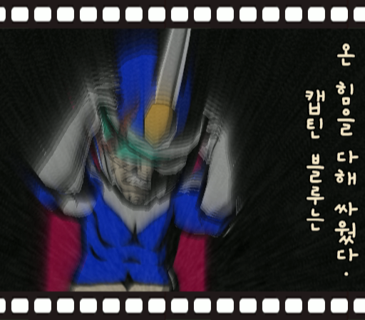
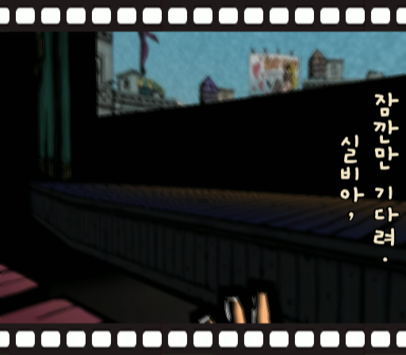
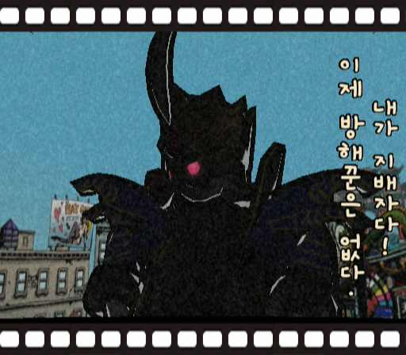

# 뷰티풀죠 리바이벌 게임큐브 한국어 패치 v0.921

일본판 **GameCube / GVFJ08**용 한국어 패치 **v0.921**입니다. v0.92에서도 제보된 **오프닝 무음·폭발 및 로봇 등장 시 정지**에 대응해 음성 처리 경로를 보완했습니다.

- 추가 자막 데이터가 없는 스트리밍 음성의 불필요한 후킹을 제거하고 원본 시작 호출로 복원했습니다.
- 효과음 자막의 검색과 상태 갱신을 다음 화면 프레임으로 옮겼습니다. 음성·효과음 시작 순간에 큰 자막 작업을 실행하지 않습니다.
- 기존 이미지 **1,443종·4,206곳**, 자막 **95개**, CONFIG 복귀 수정과 메뉴 효과를 유지합니다.
- 게임 자원 **312개의 내용과 위치**는 v0.92와 같습니다. 영상·음성 **102개의 내용과 위치**는 일본판 원본과 같습니다. 영상·음성 재인코딩은 없습니다.

**제보 환경에서 프리징이 해결됐는지는 아직 미확인입니다.** 에뮬레이터에서는 해당 정지를 재현하지 못했고, 원인을 확정한 수정으로 표시하지 않습니다.

## 적용 방법

1. [EXE 패처](https://github.com/OldManCraveGuitars-bit/GC-Viewtiful-Joe-Revival-Kr/releases/download/v0.921/Viewtiful-Joe-Revival-Kr-Patcher-v0.921.exe)를 실행합니다. EXE 하나에 필요한 파일이 포함돼 있습니다.
2. 수정되지 않은 **일본판 원본 ISO/GCM**과 새 저장 위치를 선택합니다. 기존 한글 롬에 덧씌우지 않습니다. RVZ는 먼저 돌핀에서 ISO로 변환합니다.
3. 원본 확인·적용·저장 결과 SHA-256 대조가 끝날 때까지 기다립니다.

[배포 ZIP](https://github.com/OldManCraveGuitars-bit/GC-Viewtiful-Joe-Revival-Kr/releases/download/v0.921/GC-Viewtiful-Joe-Revival-Kr-v0.921.zip) · [Xdelta](https://github.com/OldManCraveGuitars-bit/GC-Viewtiful-Joe-Revival-Kr/releases/download/v0.921/GC-Viewtiful-Joe-Revival-Kr-v0.921.xdelta) · [스크린샷](https://github.com/OldManCraveGuitars-bit/GC-Viewtiful-Joe-Revival-Kr/releases/download/v0.921/GC-Viewtiful-Joe-Revival-Kr-v0.921-screenshots.zip) · [SHA-256 목록](https://github.com/OldManCraveGuitars-bit/GC-Viewtiful-Joe-Revival-Kr/releases/download/v0.921/SHA256SUMS.txt)

## SHA-256

| 파일 | SHA-256 |
| --- | --- |
| 원본 ISO | `2b4dd8b25cf810a92bfdb153cd1632fd7229892b1cfd92ac97ec8498c6bdf480` |
| 완성 ISO | `8b5a92fbaedfce8ee719809584d548600bdd1b114908ad118305476a42afde84` |
| Xdelta | `0037dcf3f65143c76cce13593873e125cc2460fe0d152fd280cf95301408077b` |
| EXE 패처 | `e49ba90ce5d6de67335e240e788fc6e72ba64cf38b84ced2e10ffafc442ffba4` |

## 검증 범위

검증한 음성 호환성 시험본과 **게임 ISO·Xdelta가 동일**하며 패처 버전만 v0.921로 통일했습니다. CPU 캐시 정확도·MMU·저수준 DSP 설정에서 부팅부터 첫 이야기 진입 뒤까지 DSP 출력 약 120초 분량을 관찰했습니다. 별도의 약 120초 부팅 세션에서는 오프닝 영상 경로와 자막 모듈 호출을 확인했습니다. 이 시간에는 부팅과 메뉴 대기도 포함됩니다. 출력된 혼합 DSP 오디오는 무음이 아니었으며, 음성만 분리해 검증한 결과는 아닙니다.

효과음 자막의 표시·종료와 글자 밖 픽셀 보존, 이벤트 큐 검사 4개, 패처 검사 11개, 완성 v0.921 EXE의 원본 ISO 실제 적용 및 저장 결과 해시 대조를 통과했습니다. 효과음 검사는 임시 에뮬레이터 RAM에서 스테이지를 선택해 진행했습니다. 그 검사본과 배포본의 효과음 처리 코드·자막 데이터는 같고, 다른 부분은 스트리밍 음성 시작 호출을 원본으로 복원한 한 곳입니다.

첫 이야기 전체와 엔딩 전체를 이번에 다시 플레이한 결과로 표시하지 않습니다. 초기 장시간 캐시 검사의 관찰 목표는 실행 시간 제한 안에 도달하지 못했으며, 이를 게임 정지로 판정하지 않았습니다. 실기 테스트는 수행하지 않았습니다.

## 게임 화면

첫 이야기 진행 — 배포 v0.921과 동일한 게임 데이터의 에뮬레이터 XFB 캡처입니다.

대표 타이틀 이미지는 v0.92에서 촬영한 기존 캡처입니다. 타이틀을 포함한 게임 자원 312개가 v0.921과 동일하며, 촬영 버전과 원래 ISO 해시는 검증 자료에 보존했습니다.

기존 간판·종이 한글화의 디스크 텍스처 미리보기:

## 검증 자료와 라이선스

[음성 호환성 검증 범위](docs/verification/v0.921-audio-compatibility.json) · [이미지 촬영 정보](docs/verification/v0.921-screenshots.json) · [완성 EXE 실제 적용](docs/verification/v0.921-actual-apply.json) · [이전 CONFIG 검수](docs/verification/config-return-v0.92.json)

원본 ROM은 포함하지 않습니다. 패처 코드는 `LICENSE-PATCHER.md`, 내장 Xdelta는 `third_party` 라이선스를 따릅니다. 이전 v0.8·v0.9·v0.901·v0.92 태그와 배포 파일은 보존합니다.
